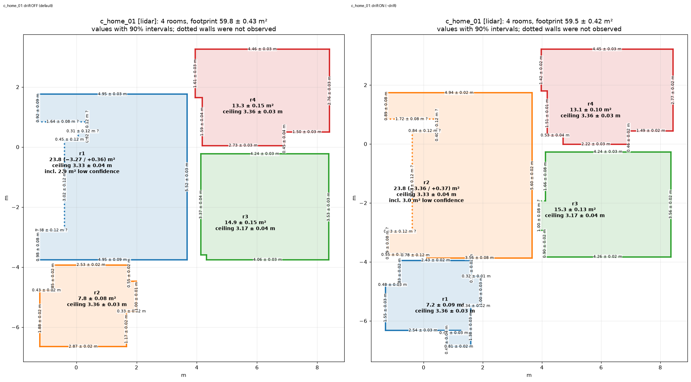
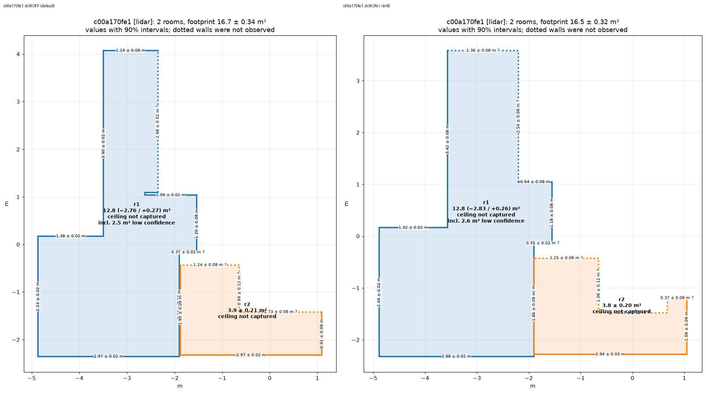

# Drift correction: method and ablation

Sat Oct 3, ~22:15 IST. Regenerate: `uv run scripts/drift_ablation.py` (plans in
`outputs/drift_off/` and `outputs/drift_on/`); room scores:
`uv run scripts/score_rooms.py --plan outputs/drift_<off|on>/c_home_01_lidar/plan.json`.

## Method (`src/floorplan/drift.py`, `floorplan run <capture> --drift`)

ARKit poses drift slowly, so a wall seen early and again late lands in two places. The
frames are cut into chunks of 150 (of the ≤ 3000 used); each chunk's wall points
(0.1–2.3 m above the floor, top-down) are registered to all earlier, already-corrected
chunks with trimmed 2D ICP (yaw about the vertical + horizontal shift, pairs within
10 cm). A chunk's correction is kept only if ≥ 50% of its wall points find a partner,
the matched walls constrain both horizontal directions (wall-normal check, so a fit
sliding along one wall is rejected), |yaw| < 3° and shift < 0.3 m. Corrections are
interpolated per frame between chunk centres. Height is left alone (the floor fixes it).

## Measuring drift first

`uv run scripts/drift_probe.py <capture>` tracks each isolated wall's position per time
chunk. Revisited walls move by up to 8.8 cm (`c_home_01`) and 12.9 cm (A `c7d28f72c6`),
but single-room scans already spread 4–6 cm (partial views, furniture). So the probe
cannot separate drift from noise; drift here is at most ~5–10 cm. The ablation below is
judged on outputs instead.

## Ablation: every LiDAR capture, off → on

Wall ± = half-width of each observed wall's 90% length interval (from its face spread;
8.2–8.6 cm means no wall face was found behind the outline edge).

| Capture | Rooms | Area (m²) | Wall ±, median (cm) | Wall ±, p90 (cm) | Correction |
|---|---|---|---|---|---|
| A 1a8384c3f6 | 6 → 6 | 51.8 → 52.8 | 2.7 → 3.3 | 8.5 → 8.5 | 9 of 17 chunks (max 2.55°, 13.5 cm) |
| A c00a170fe1 | 2 → 2 | 16.7 → 16.5 | **2.3 → 8.3** | 8.5 → 8.6 | 6 of 11 (max 1.46°, 8.3 cm) |
| A c7d28f72c6 | 5 → 5 | 53.2 → 53.1 | 2.8 → 2.8 | 8.4 → 8.4 | 14 of 16 (max 1.24°, 14.0 cm) |
| B 42444946 | 1 → 1 | 15.0 → 15.1 | 3.5 → 3.3 | 4.2 → 4.0 | 3 of 6 (max 0.25°, 1.4 cm) |
| B 42444949 | 1 → 1 | 15.0 → 14.9 | 3.7 → 3.3 | 8.5 → 8.4 | 2 of 5 (max 0.71°, 4.8 cm) |
| B 42444950 | 1 → 1 | 14.8 → 14.8 | 2.8 → 2.5 | 3.2 → 3.2 | 3 of 5 (max 0.24°, 1.4 cm) |
| C c_damage_01 | 1 → 1 | 13.1 → 12.9 | 2.6 → 2.6 | 2.7 → 3.1 | 12 of 12 (max 2.20°, 17.4 cm) |
| C c_damage_02 | 1 → 1 | 12.4 → 12.8 | 3.0 → 3.3 | 3.4 → 3.7 | 9 of 11 (max 1.24°, 11.9 cm) |
| C c_home_01 | 4 → 4 | 59.8 → 59.5 | 2.9 → 2.6 | **3.7 → 8.4** | 12 of 16 (max 1.48°, 18.5 cm) |

Multi-room capture `c_home_01`, rooms vs hand labels (IoU), off → on: room2 0.85 → 0.86,
hall 0.79 → 0.78, room1 0.76 → 0.75, kitchen 0.60 → 0.65; 4/4 found both ways.

Repeatability, the one measure the correction cannot fit to (two independent scans of
the damage room, same walls):

| Dimension | off: 01 vs 02 | on: 01 vs 02 |
|---|---|---|
| short side | 3.296 vs 3.084 (21 cm) | 3.201 vs 3.191 (**1.0 cm**) |
| long side | 4.242 vs 4.263 (2.1 cm) | 4.260 vs 4.258 (0.2 cm) |
| notch, short axis | 0.655 vs 0.505 (15 cm) | 0.532 vs 0.580 (4.8 cm) |
| notch, long axis | 1.298 vs 1.388 (9 cm) | 1.298 vs 1.415 (11.7 cm) |
| area | 13.13 vs 12.44 m² | 12.94 vs 12.77 m² |

## Verdict

**Mixed, so off by default.** On: the damage room's two scans agree on its short side to
1 cm instead of 21 cm, B's wall faces sharpen slightly, `c_home_01`'s median face
sharpens and its kitchen IoU rises. But A's low scan `c00a170fe1` loses wall support
(median 2.3 → 8.3 cm: walls with no face found) and `c_home_01`'s worst walls lose it too
(p90 3.7 → 8.4 cm). A correction that helps some captures and breaks others is not done.

Open: why `c00a170fe1` gets worse (its scan never sees above 1.7 m, so its chunks hold
thin, low wall strips; the overlap and constraint checks pass anyway). Also, a 62 s
single-room scan receiving 17 cm corrections is either real ARKit drift (~1% of its 15 m
path) or ICP error; the repeatability result points to real drift, but this is not proven.

**Decision (user, Sat ~22:40 IST): off by default.** The plans settled it: with `--drift`
the kitchen of `c_home_01` gets a ragged outline and A `c00a170fe1`'s north arm shortens
by ≈ 0.5 m (left: off, right: on):

Brief requirement (COMPLIANCE G5): "poses used as-is" fails. The report must therefore
state the method, this ablation and why it is off; a correction that does no harm on
these plans is still open work.
