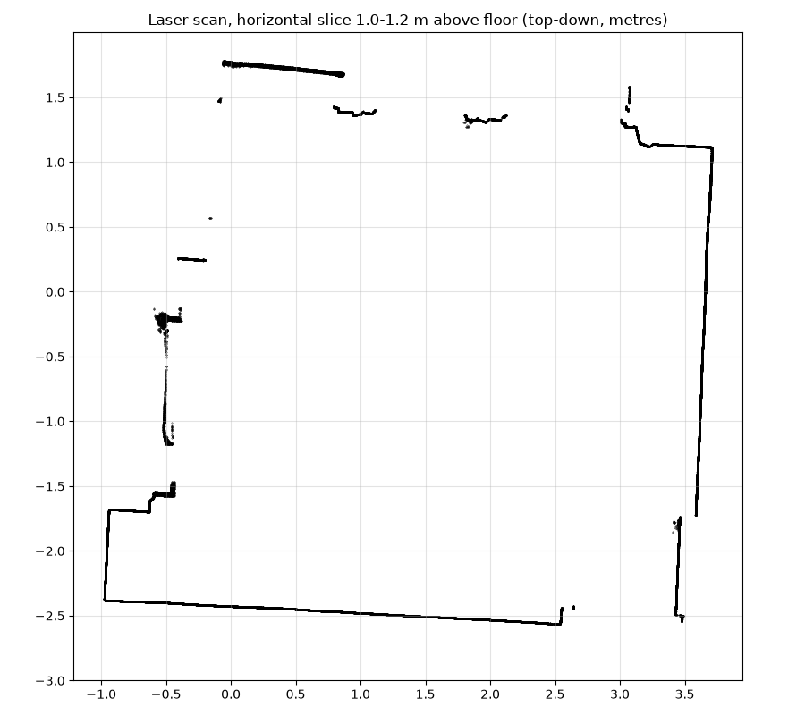

# Measuring a laser scan: ground-truth sheet

Thank you for helping. This is one room scanned by a professional laser scanner (Faro,
accurate to about a millimetre), from the public ARKitScenes dataset. Our software measures
the same room from an iPad's much rougher LiDAR. Your measurements become the "true"
values we score it against, so they matter more than the drawing.

About 1–2 hours. Precision target: **5 mm**.

## Files

| File | Use it in |
|---|---|
| `arkitscenes_421337_room.e57` (40 MB) | Autodesk ReCap → Revit / AutoCAD, Archicad, CloudCompare |
| `arkitscenes_421337_room.las` (69 MB) | Same, if E57 gives trouble |
| `arkitscenes_421337_room.ply` (72 MB) | CloudCompare (free), Rhino |
| `overview.png` | Top-down preview, to check the file opened correctly |

- Units are **metres**, z is up. Coordinates carry an arbitrary offset (z is around 227 to
  231): ignore it, or move the origin. Distances are unaffected.
- The cloud is real scanner points thinned to one per 5 mm, cropped to the room. Points
  seen through windows were removed.
- If you have no CAD tool to hand, CloudCompare is free (cloudcompare.org): open the `.ply`,
  use *Tools → Segmentation → Cross Section* for the slice and the point-picking tool for
  distances.

## Three rules

1. **Please measure before looking at any of our results.** If you have seen our plan, you
   will unconsciously match it.
2. **Measure along the walls, not along x and y.** The room is rotated about 2° from the
   axes, so use aligned dimensions.
3. **Write down anything ambiguous** rather than guessing silently: a wall hidden behind
   furniture, a corner that is not square, a gap in the scan. The scanner stood in one
   place, so some wall areas are in shadow.

## Step 1: number the walls and openings

On the slice above (or your own section at the same height):

- **W1** is the long wall at the bottom of the image (y ≈ -2.5). Continue **anticlockwise**
  W2, W3, … Every straight piece of wall between two corners gets its own number,
  including short returns and steps down to about 10 cm.
- Doors **D1, D2…**, windows **N1, N2…**, open passages without a door **P1…**
- Gaps in the slice may be openings, furniture shadows, or recesses: check in 3D, and
  tell us which.

## Step 2: measure

- **Wall length:** inside face to inside face, corner to corner, horizontally, in a section
  at **1.1 m** above the floor. If that part of the wall is hidden at 1.1 m, measure at the
  nearest height where it is visible, and write the height down.
- **Ceiling height:** floor plane to ceiling plane at **four points**, one near each corner
  (about 0.5 m from the walls). Note any beam, bulkhead or slope.
- **Openings:** clear width, jamb to jamb (inside the frame), and height (floor to head).
  For windows also the sill height.
- **Floor area:** area of the closed outline traced along the inside faces at 1.1 m. No
  deduction for furniture.
- **±:** if you are less sure than 5 mm about a value (a fuzzy edge, an occluded corner),
  put your own estimate of the uncertainty in the ± column.

## Walls

| Wall | Length (m) | Measured at height (m) | ± (mm) | Notes |
|---|---|---|---|---|
| W1 | | | | |
| W2 | | | | |
| W3 | | | | |
| W4 | | | | |
| W5 | | | | |
| W6 | | | | |
| W7 | | | | |
| W8 | | | | |
| W9 | | | | |
| W10 | | | | |

More walls? Continue on the back.

## Ceiling height

| Point | Near which corner (walls) | Floor to ceiling (m) | Notes |
|---|---|---|---|
| C1 | | | |
| C2 | | | |
| C3 | | | |
| C4 | | | |

## Openings

| ID | Door / window / passage | On wall | Clear width (m) | Height (m) | Sill height (m) | Notes |
|---|---|---|---|---|---|---|
| D1 | | | | | | |
| D2 | | | | | | |
| N1 | | | | | | |
| N2 | | | | | | |
| P1 | | | | | | |

## Floor area and remarks

| Item | Value | Notes |
|---|---|---|
| Floor area (m²) | | |
| Anything unusual about the room | | |
| Software used | | |
| Time spent | | |

## What to send back

- This sheet filled in (a photo is fine, a typed copy even better)
- The slice (or your section) with your W / D / N / P numbers marked on it
- Your drawing, if you made one (DWG or PDF): useful, but the numbers come first
